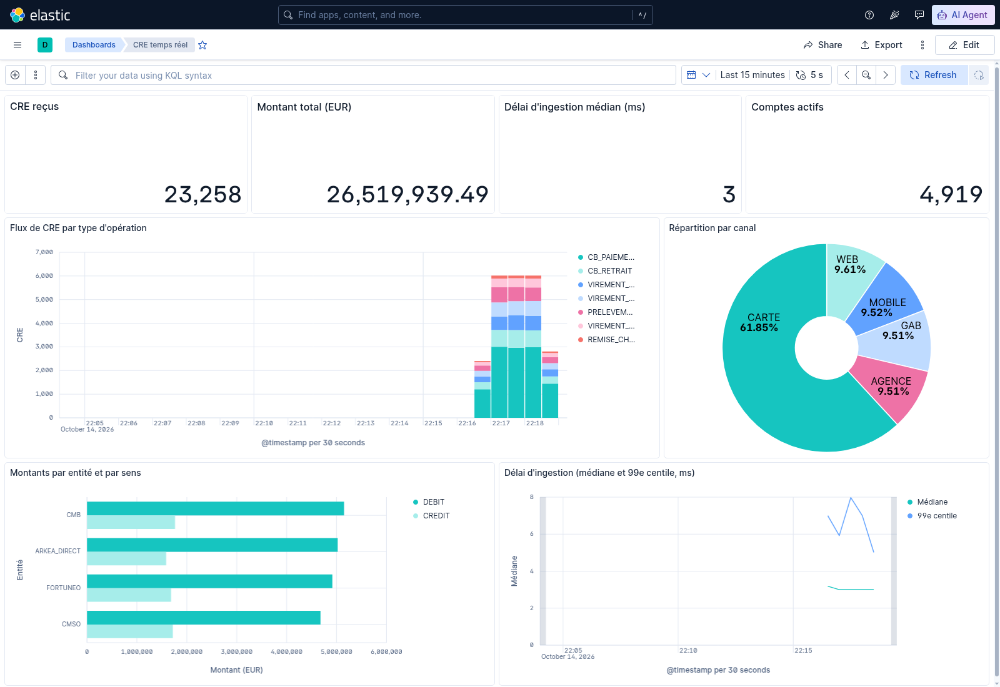
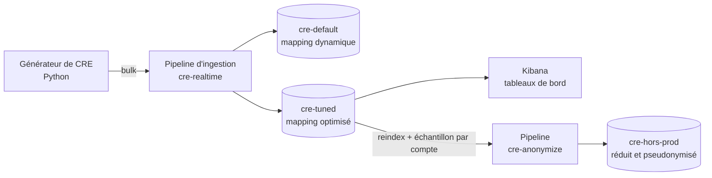

# CRE Realtime Elastic

Restitution **temps réel, haute fréquence et 24h/24** de comptes rendus d'événements bancaires (CRE) sur Elasticsearch, avec une étude des **Doc Values** de Lucene (fichiers `.dvm` / `.dvd`) et la constitution d'un **jeu de données hors production réduit et pseudonymisé**.

Toutes les données sont synthétiques : aucun IBAN, nom ou montant ne correspond à une personne réelle.

## Ce que montre le projet

| Sujet | Résultat mesuré (1 million de CRE) |
|---|---|
| Restitution temps réel | Un CRE publié est trouvable en **moins d'une seconde** (médiane ~810 ms, limitée par le refresh de 1 s) |
| Optimisation des Doc Values | Fichiers `.dvd` : **66 → 19 Mo (−71 %)** |
| Taille de l'index | **371 → 264 Mo (−29 %)** |
| Débit d'ingestion | **23 000 → 30 000 CRE/s (+28 %)** sur un seul nœud |
| « Derniers CRE » (tri d'index) | **21 ms → moins d'1 ms** |
| Hors production | 10 % des comptes conservés avec tout leur historique, **0 IBAN réel** retrouvé |

Le détail est dans [`results/bench.md`](results/bench.md) et l'explication technique dans [`docs/doc-values.md`](docs/doc-values.md).



## Architecture



- **`cre-realtime`** horodate l'arrivée de chaque CRE et calcule `ingest_lag_ms` (délai génération → ingestion), consultable dans Kibana.
- **`cre-default`** laisse Elasticsearch deviner le mapping : c'est le point de comparaison.
- **`cre-tuned`** applique un mapping strict, pensé champ par champ (Doc Values seulement là où on agrège ou trie, `match_only_text`, `scaled_float`, `constant_keyword`, tri d'index par date).
- **`cre-anonymize`** pseudonymise IBAN, compte et titulaire avec un hachage salé et masque les références dans les libellés. Le même compte donne toujours le même pseudonyme : les historiques restent cohérents pour les tests.

## Démarrage

Prérequis : Docker, Python 3.11 ou plus récent, environ 4 Go de RAM libre.

```bash
make install      # environnement Python
make up           # Elasticsearch 9.4 + Kibana 9.4 (localhost uniquement)
make setup        # pipelines et index
make stream       # publie 500 CRE/s pendant 60 s et mesure la restitution
make bench        # benchmark complet sur 1 million de CRE (~2 min)
make anonymize    # jeu hors production à 10 % des comptes
make lucene       # fichiers Lucene de l'index optimisé et en-têtes .dvm
make kibana       # vues de données + tableau de bord "CRE temps réel"
make demo         # flux continu de 200 CRE/s pendant 1 h, pour voir le tableau de bord bouger
make test
```

Kibana : <http://localhost:5601/app/dashboards#/view/cre-temps-reel> (rafraîchi toutes les 5 s sur les 15 dernières minutes). Pour explorer les CRE un par un : menu **Discover**, vue de données **CRE temps réel** ou **CRE hors production (anonymisé)**.

Pour l'anonymisation, définir un vrai sel secret : `export CRE_ANON_SALT=...`.

## Choix de conception

**Échantillonner par compte, pas par événement.** Garder 10 % des CRE au hasard casserait les historiques (soldes incohérents, séquences incomplètes). Le filtre retient 10 % des comptes et **tous** leurs CRE. Il s'appuie sur un script qui lit `doc['account_id']`, c'est-à-dire sur les Doc Values de ce champ.

**Pseudonymiser de façon déterministe.** Un hachage SHA-256 salé produit toujours le même pseudonyme pour un même compte, ce qui préserve les jointures entre jeux de données. Contrepartie : le sel doit rester secret, sinon on pourrait retrouver un IBAN connu en le hachant.

**Mesurer la restitution de bout en bout.** Le délai d'ingestion seul ne suffit pas : un CRE n'est visible qu'après le refresh de l'index. Le flux publie donc régulièrement un CRE « sonde » et mesure le temps jusqu'à ce qu'une recherche le trouve.

**Désactiver les fichiers composés dans le lab.** `index.compound_format: false` laisse apparaître chaque fichier Lucene (`.dvm`, `.dvd`, `.tim`…) au lieu de les regrouper dans un `.cfs`. C'est utile pour l'étude, mais à laisser par défaut en production.

## Limites et pistes

- Un seul nœud et aucun réplica : en production 24h/24, il faudrait au moins 3 nœuds, des réplicas et des snapshots.
- La sécurité Elasticsearch est désactivée pour simplifier le lab local.
- Pistes : alimentation par Kafka (capture de changements depuis la base source), politique de cycle de vie (ILM) chaud / tiède / froid, data streams, alerting sur `ingest_lag_ms`.

## Structure

```
docker-compose.yml   Elasticsearch + Kibana
elastic/             mappings et pipelines d'ingestion (JSON)
src/cre/             générateur, flux, benchmark, anonymisation, lecture Lucene, Kibana
docs/doc-values.md   explication des fichiers .dvm / .dvd
results/             derniers résultats mesurés
tests/               tests unitaires
```
